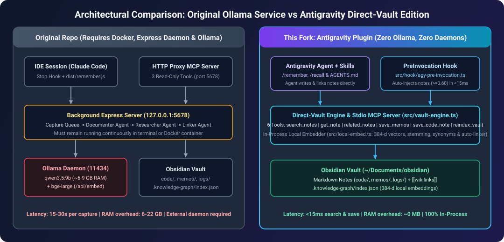
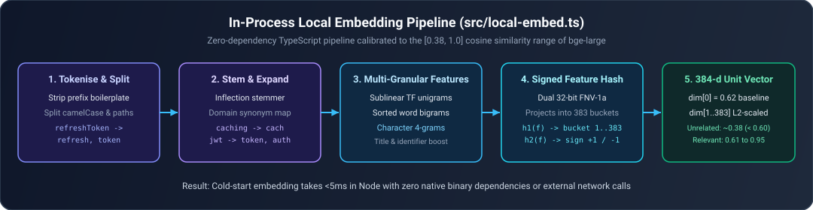
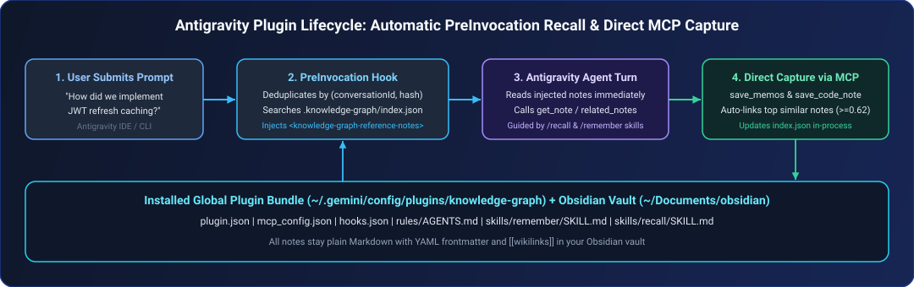

# knowledge-graph (Antigravity & Ollama-Free Edition)

**You forget. Your agents forget. Your knowledge graph doesn't.**

Build your personal knowledge graph locally in your **Obsidian** vault. Every decision, lesson and code note you work through with an agent is kept as linked Markdown notes on your own machine, ready for the next agent that needs it in any session or project.

This repository is a fork of [lukewoodcock/knowledge-graph](https://github.com/lukewoodcock/knowledge-graph) refactored to run **100% in-process inside Google Antigravity without requiring Ollama, Docker or a background Express daemon**, whilst preserving full backwards compatibility with the original HTTP webhook service.



---

## What Changed in This Fork

In the upstream repository, using the knowledge graph required running two background servers at all times:
1. An **Ollama** server (`127.0.0.1:11434`) holding a 6GB to 22GB local LLM (`qwen3.5:9b`) for note writing and linking alongside `bge-large` for embeddings.
2. An **Express HTTP daemon** (`127.0.0.1:5678`) that queued webhook payloads from Claude Code hooks and polled run status in memory.

In this fork, we replaced both background daemons with an **all-in-one stdio MCP server**, a **zero-dependency in-process TypeScript embedding engine** (`src/local-embed.ts`) and a **native Google Antigravity plugin** (`antigravity-plugin/knowledge-graph/`) with automatic `PreInvocation` context injection enabled by default.

| Capability | Original Repository (`lukewoodcock/knowledge-graph`) | This Fork (Antigravity Direct-Vault Edition) |
| :--- | :--- | :--- |
| **Embedding Engine** | External Ollama HTTP call (`/api/embed` with `bge-large`) | In-process 384-dimensional TypeScript embedder (`src/local-embed.ts`) in `<5ms` |
| **Note Writing & Linking** | Queued in the background via `202 Accepted` (`15s-30s` per Ollama `Documenter` and `Linker` run before notes are searchable, whilst `dist/remember.js` polls until completion) | Antigravity writes notes directly via MCP (`save_memos`, `save_code_note`) and `autoLinkNote()` links related notes by vector similarity (`>= 0.62`) immediately |
| **MCP Server** | 3 read-only tools proxying HTTP calls to `localhost:5678` | 6 direct-vault tools (`search_notes`, `get_note`, `related_notes`, `save_memos`, `save_code_note` and `reindex_vault`) operating straight on `VAULT_PATH` |
| **Context Injection** | Claude Code `UserPromptSubmit` hook calling `localhost:5678` | Native Antigravity `PreInvocation` hook (`src/hook/agy-pre-invocation.ts`) searching the vault in-process with per-prompt deduplication |
| **Packaging** | Per-project `.mcp.json` and `.claude/settings.json` copies | Global Antigravity plugin (`~/.gemini/config/plugins/knowledge-graph`) installed via `npm run install:antigravity` |

---

## Visual Walkthrough & Code Changes from the Original Repo

### 1. Replacing Ollama `/api/embed` with In-Process 384-Dimensional Embeddings



In the original repository, `src/ollama.ts` always made a network call to `${endpoint.url}/api/embed`. If Ollama was not running, every search, capture and context-injection hook failed.

#### Before (`src/ollama.ts` in upstream)

```ts
export async function embed(endpoint: OllamaEndpoint, model: string, input: string[]): Promise<number[][]> {
  if (input.length === 0) return [];
  const res = await fetch(`${endpoint.url}/api/embed`, {
    method: 'POST',
    headers: headers(endpoint),
    body: JSON.stringify({ model, input, truncate: true }),
  });

  if (!res.ok) {
    throw new Error(`Ollama embed request failed: HTTP ${res.status} ${res.statusText}`);
  }
  const embeddings = ((await res.json()) as { embeddings?: unknown }).embeddings;
  return embeddings as number[][];
}
```

#### After (`src/ollama.ts` + `src/local-embed.ts` in this fork)

When `OLLAMA_EMBED_MODEL=local` (now the default for the Antigravity plugin and direct-vault engine), `embed()` bypasses the network entirely and runs `localEmbed(input)` in memory:

```ts
import { isLocalEmbed, localEmbed } from './local-embed';

export async function embed(endpoint: OllamaEndpoint, model: string, input: string[]): Promise<number[][]> {
  if (input.length === 0) return [];
  if (isLocalEmbed(model, endpoint.url)) {
    return localEmbed(input);
  }
  const res = await fetch(`${endpoint.url}/api/embed`, {
    method: 'POST',
    headers: headers(endpoint),
    body: JSON.stringify({ model, input, truncate: true }),
  });
  // ... falls back to Ollama HTTP only when explicitly configured
}
```

Inside `src/local-embed.ts`, each Markdown section is tokenised, split across `camelCase`, `snake_case` and file paths, stemmed (`caching` -> `cach`, `limiting` -> `limit`, `decisions` -> `decis`), expanded with software engineering synonyms (`jwt` -> `token`, `auth`, `refresh`), combined with word bigrams and character 4-grams and projected via dual 32-bit FNV-1a signed feature hashing into a 384-dimensional unit vector:

```ts
// Calibrated baseline in dimension 0 so unrelated notes score ~0.384 (< 0.60)
// whilst relevant notes score 0.61 to 0.96, matching bge-large's threshold.
const BASELINE = 0.62;
const FEATURE_SCALE = Math.sqrt(1 - BASELINE * BASELINE);

export function embedOneLocal(text: string): number[] {
  const vec = new Float64Array(LOCAL_EMBED_DIM);
  const tokens = tokenize(text);
  if (tokens.length === 0) {
    vec[0] = 1;
    return Array.from(vec);
  }
  // ... weights unigrams, domain synonyms, char 4-grams and word bigrams ...
  const invNorm = FEATURE_SCALE / Math.sqrt(normSq);
  vec[0] = BASELINE;
  for (let i = 1; i < LOCAL_EMBED_DIM; i++) {
    vec[i] *= invNorm;
  }
  return Array.from(vec);
}
```

---

### 2. Upgrading the MCP Server from a 3-Tool HTTP Proxy to a 6-Tool Direct-Vault Engine



In the original repository, `src/mcp/server.ts` exposed only three read-only tools (`search_notes`, `get_note` and `related_notes`), each of which called `fetch('http://127.0.0.1:5678/webhook/knowledge-graph/...')`. Writing notes happened outside MCP: the Claude Code `Stop` hook posted code diffs to the service (`202 Accepted`) where Ollama's `Documenter` and `Linker` agents ran asynchronously in a background queue (`15s-30s` before the note became searchable), whilst `/remember` shelled out to `node dist/remember.js` and polled `/webhook/knowledge-graph/runs/:id` waiting for the queue and `Linker` to finish.

#### Before (`src/mcp/server.ts` in upstream)

```ts
export function buildMcpServer(baseUrl: string): McpServer {
  const server = new McpServer({ name: 'knowledge-graph', version: '1.0.0' });

  for (const name of GRAPH_TOOL_NAMES) {
    const { description, inputSchema } = GRAPH_TOOLS[name];
    server.registerTool(name, { description, inputSchema }, async (args: unknown): Promise<CallToolResult> => {
      const reply = await callGraphTool(baseUrl, name, args);
      return { content: [{ type: 'text', text: reply.text }], ...(reply.isError && { isError: true }) };
    });
  }

  return server;
}
```

#### After (`src/mcp/server.ts` + `src/vault-engine.ts` in this fork)

`src/mcp/server.ts` now provides `buildDirectMcpServer()`, powered by `createDirectVaultEngine()` in `src/vault-engine.ts`. It operates directly on `VAULT_PATH` and adds three write and indexing tools (`save_memos`, `save_code_note` and `reindex_vault`) with automatic vector-similarity `[[wikilink]]` linking:

```ts
export function buildDirectMcpServer(cfg: Config = loadLocalVaultConfig()): McpServer {
  const server = new McpServer({ name: 'knowledge-graph', version: '1.0.0' });
  const engine = createDirectVaultEngine(cfg);

  for (const name of DIRECT_VAULT_TOOL_NAMES) {
    const { description, inputSchema } = DIRECT_VAULT_TOOLS[name];
    server.registerTool(name, { description, inputSchema }, async (args: unknown): Promise<CallToolResult> => {
      const reply = await engine.callTool(name, args);
      return { content: [{ type: 'text', text: reply.text }], ...(reply.isError && { isError: true }) };
    });
  }

  return server;
}
```

When `save_memos` or `save_code_note` writes a note, `autoLinkNote()` in `src/vault-engine.ts` replaces the Ollama `Linker` agent by searching the local embedding index and appending `## Related Notes` `[[wikilinks]]` for the top candidates scoring `>= 0.62`:

```ts
const { frontmatter, body } = parseNote(content);
const query = `${frontmatter.title || title}\n\n${body.trim()}`.substring(0, 1500);
const hits = await index.search(query, { limit: LINK_CANDIDATES + 5 });
for (const hit of hits) {
  if (chosen.length >= MAX_AUTO_LINKS) break;
  if (hit.path === selfRel || hit.name === selfName) continue;
  if (alreadyLinked.has(hit.name) || chosen.includes(hit.name)) continue;
  if (hit.score >= AUTO_LINK_MIN_SCORE) {
    chosen.push(hit.name);
  }
}
```

---

### 3. Native Antigravity `PreInvocation` Context Injection (`src/hook/agy-pre-invocation.ts`)

In the original repository, `src/hook/prompt.ts` implemented a Claude Code `UserPromptSubmit` hook that posted the prompt over HTTP to `localhost:5678` and returned `hookSpecificOutput.additionalContext`.

In this fork, we added `src/hook/agy-pre-invocation.ts` for Antigravity's `PreInvocation` lifecycle event. It reads `lastUserInput` and `conversationId` from `stdin`, deduplicates per `(conversationId, sha256(lastUserInput))` so multi-step tool loops within the same turn never re-inject the same notes, searches `.knowledge-graph/index.json` in-process and returns an Antigravity `injectSteps` payload:

```ts
export async function runAgyPreInvocation(
  input: AgyPreInvocationInput,
  env: NodeJS.ProcessEnv = process.env,
  opts: { deduplicate?: boolean } = {},
): Promise<AgyPreInvocationOutput> {
  const injCfg = loadInjectionConfig(env);
  if (injCfg.disabled) return {};

  const rawPrompt = (input.lastUserInput ?? input.prompt ?? '').trim();
  if (!rawPrompt || rawPrompt.startsWith('/')) return {};

  if (opts.deduplicate !== false && (await alreadyInjectedForPrompt(input.conversationId, rawPrompt))) {
    return {};
  }

  const vaultCfg = loadLocalVaultConfig(env);
  const index = createEmbeddingIndex(vaultCfg);
  const indexPath = path.join(vaultCfg.vaultPath, '.knowledge-graph', 'index.json');
  try {
    await fs.access(indexPath);
  } catch {
    await index.sync();
  }

  const query = rawPrompt.slice(0, MAX_QUERY_CHARS);
  const results = await index.search(query, { limit: injCfg.maxNotes });
  const context = renderContext(results, injCfg);
  if (!context) return {};

  return {
    injectSteps: [
      {
        systemMessage: {
          systemMessage: context,
        },
      },
    ],
  };
}
```

---

## Installation & Quick Start for Google Antigravity (No Ollama or Docker Needed)

### Prerequisites
- **Node.js 20+** and **npm**
- **Google Antigravity** (IDE or CLI)
- An **Obsidian** vault folder on your machine (or any directory where you want your Markdown notes stored)

### Step-by-Step Installation

1. **Clone the repository and build the TypeScript sources**

   ```bash
   git clone https://github.com/alaric-visi/knowledge-graph.git
   cd knowledge-graph
   npm install
   npm run build
   ```

2. **Run the Antigravity plugin installer with your Obsidian vault path**

   Pass the path to your Obsidian vault via `VAULT_PATH` or the `--vault` flag (if omitted, it defaults to `~/Documents/obsidian`):

   ```bash
   VAULT_PATH="/path/to/your/obsidian-vault" npm run install:antigravity
   # Or using the --vault flag:
   node scripts/install-antigravity.mjs --vault ~/Documents/MyObsidianVault
   ```

   What the installer (`scripts/install-antigravity.mjs`) does automatically:
   1. Copies the plugin template from `antigravity-plugin/knowledge-graph/` into `~/.gemini/config/plugins/knowledge-graph/`.
   2. Replaces the `__REPO_ROOT__` and `__VAULT_PATH__` placeholders across `mcp_config.json`, `hooks.json`, `rules/AGENTS.md` and `skills/*/SKILL.md` with your machine's resolved repository path and Obsidian vault path.
   3. Initialises the `code/`, `memos/` and `logs/` subdirectories inside your Obsidian vault.
   4. Syncs and embeds your existing Obsidian notes into `<vault>/.knowledge-graph/index.json` using the in-process local embedder (`src/local-embed.ts`).

3. **Use the Knowledge Graph in Antigravity**

   The plugin loads live in Antigravity without requiring a restart:
   - **Automatic Recall (`PreInvocation` hook)**: Enabled by default. Every time you submit a prompt in any workspace, the hook searches your vault in `<15ms` and injects the top matching notes (`score >= 0.60`) inside a `<knowledge-graph-reference-notes>` system message block.
   - **Save Notes (`/remember`)**: Type `/remember` (or ask the agent to save a decision, learning, todo, snippet or code note) to write and automatically link notes into your vault.
   - **Search & Traverse (`/recall`)**: Type `/recall <question>` to search your vault by meaning, open full notes and walk incoming and outgoing `[[wikilinks]]`.
   - **Change Vault Path Later**: Re-run `VAULT_PATH="/new/vault/path" npm run install:antigravity` at any time to point the plugin at a different vault.

### Direct-Vault MCP Tools Available in Antigravity

| MCP Tool | Arguments | What It Does |
| :--- | :--- | :--- |
| `search_notes` | `query, limit = 5, type?, kind?, status?` | Embeds `query` locally and ranks vault sections by cosine similarity |
| `get_note` | `name` | Reads a note's Markdown content and YAML frontmatter by `[[wikilink]]` name |
| `related_notes` | `name` | Lists outgoing and incoming `[[wikilinks]]` for a note |
| `save_memos` | `project, memos[], session_id?` | Writes `decision`, `learning`, `todo`, `snippet` or `conversation` memos into `vault/memos/`, links same-session and similar notes and updates the index |
| `save_code_note` | `file_path, language, project, title, summary, key_points[], ...` | Writes a structured code note into `vault/code/`, auto-links related notes, appends to `vault/logs/` and indexes it |
| `reindex_vault` | `rebuild = false` | Syncs changed/new notes (or rebuilds `.knowledge-graph/index.json` from scratch when `rebuild: true`) |

---

## Legacy HTTP Service & Ollama Mode (Backwards-Compatible)

Everything from the original HTTP service remains intact if you wish to run the standalone Express server with Ollama or Claude Code hooks:

- **Documenter**: summarises what you are building into a structured note (`vault/code/`).
- **Researcher**: generates a best-practices and pitfalls note (`vault/research/`). Off by default; set `RESEARCHER_ENABLED=true` to turn it on.
- **Linker**: connects new notes to existing ones with `[[wikilinks]]`, choosing from the ten notes most similar to each new note.

For the whole loop on one page (capture, run, vault and recall, the trade-offs and the safety decisions), see [docs/architecture.md](docs/architecture.md).

```bash
cp .env.example .env        # set VAULT_HOST_PATH to your vault
docker compose up -d --build
docker exec -it ollama ollama pull qwen3.5:9b
docker exec -it ollama ollama pull bge-large   # embeddings for search
```

Podman on macOS works identically: `podman compose up -d --build`. Compose publishes both the service (5678) and Ollama (11434) on the host's loopback only.

Without compose, publish the image's port on loopback too: the image listens on every interface inside the container (`HOST=0.0.0.0`), so the `-p` address is what keeps it private.

```bash
docker build -t knowledge-graph .
docker run -d -p 127.0.0.1:5678:5678 -v /path/to/vault:/vault \
  -e OLLAMA_URL=http://host.docker.internal:11434 knowledge-graph
```

### Without local chat models in HTTP mode

In HTTP mode, the Documenter and Linker (and the Researcher, when it is on) use a chat model and search uses an embedding model (or `OLLAMA_EMBED_MODEL=local`). If your machine cannot run the chat model, you can run chat in the cloud:

- **The Ollama app, with a cloud model.** Install Ollama, run `ollama signin` and set `OLLAMA_MODEL` to a cloud model such as `gpt-oss:120b-cloud`. The app passes chat to Ollama's servers whilst embeddings stay local (`OLLAMA_EMBED_MODEL=local` or `bge-large`).
- **Hosted Ollama directly, with no chat model installed.** Create an API key in your account at [ollama.com](https://ollama.com) and set:

  ```bash
  OLLAMA_URL=https://ollama.com
  OLLAMA_API_KEY=<your key>
  OLLAMA_MODEL=gpt-oss:120b              # the plain name; "-cloud" is the app's
  OLLAMA_EMBED_MODEL=local               # in-process local embeddings (or bge-large on local Ollama)
  ```

### Trigger from the IDE (HTTP Webhook Mode)

```bash
curl -s -X POST http://localhost:5678/webhook/knowledge-graph/trigger \
  -H "Content-Type: application/json" \
  -d '{
    "file_path":    "src/auth/jwt.py",
    "language":     "python",
    "description":  "Implemented JWT token refresh with sliding expiry window",
    "changed_code": "def refresh_token(user_id, token): ..."
  }' | jq .
```

Payload: at least one of `file_path` / `description` is required; `language` and `changed_code` are optional. So are `session_id` and `project` (the codebase, named after its git repository): when sent, they are recorded as `session` and `project` in the frontmatter of every note the run writes and when left out those fields are simply absent.

The Documenter's note is `code/<date>_<project>_<file path>.md` (for example `code/2026-06-10_project-a_src_auth_jwt.py.md`), so two projects changing a file of the same name on the same day get a note each. Without a `project` the name is just `<date>_<file path>`.

The service replies `202 Accepted` straight away and the agents run in the background:

```json
{ "status": "accepted", "run_id": "3f2c...", "status_url": "/webhook/knowledge-graph/runs/3f2c..." }
```

Poll the status URL. It returns `{"status": "running"}` until the run finishes, then the full result:

```bash
curl -s http://localhost:5678/webhook/knowledge-graph/runs/3f2c... | jq .
```

```json
{
  "run_id": "3f2c...",
  "status": "complete",
  "session_date": "2026-06-10",
  "file_path": "src/auth/jwt.py",
  "language": "python",
  "notes": [
    { "agent": "documenter", "note_path": "/vault/code/2026-06-10_src_auth_jwt.py.md", "title": "src_auth_jwt.py" },
    { "agent": "researcher", "note_path": "/vault/research/2026-06-10_research_Implemented_JWT....md", "title": "..." }
  ],
  "linker": { "status": "success", "links_written": 1 }
}
```

### Send Memos Over HTTP

A memo is a capture the agent in your session already wrote: a `learning`, `decision`, `todo`, `snippet` or `conversation`. Memos skip the Documenter and Researcher. Send one memo, a JSON array of them or `{"memos": [...]}` (at most 20):

```bash
curl -s -X POST http://localhost:5678/webhook/knowledge-graph/memo \
  -H "Content-Type: application/json" \
  -d '{
    "memos": [{
      "kind":       "decision",
      "title":      "Use write-through caching",
      "body":       "In project-a we chose write-through caching because...",
      "project":    "project-a",
      "session_id": "5d1e...",
      "files":      ["src/cache.ts"]
    }]
  }' | jq .
```

### Search the Graph Over HTTP

Every note is embedded by `##` section (with `local` in-process embeddings or `bge-large` via Ollama) as soon as a run writes it, so a run's notes are searchable by the time the run finishes. Each `##` section is embedded on its own with the note's title, type, kind (for a memo), project and a one-line summary in front of it, so a section like "Key Points" still matches questions about the note's topic. A section over 1500 characters is split at paragraph breaks into chunks that keep its heading.

```bash
curl -s -X POST http://localhost:5678/webhook/knowledge-graph/search \
  -H "Content-Type: application/json" \
  -d '{"query": "how did I refresh JWTs?", "limit": 5}' | jq .
```

### Open a Note and Walk Its Links Over HTTP

A note's name is its file name without `.md`, as a `[[wikilink]]` names it and as search returns it.

```bash
curl -s http://localhost:5678/webhook/knowledge-graph/notes/cache-decision | jq .
curl -s http://localhost:5678/webhook/knowledge-graph/notes/cache-decision/related | jq .
```

---

## Development

```bash
npm install
npm run dev                  # hot-reload dev server (tsx watch)
npm run typecheck            # tsc --noEmit
npm test                     # vitest unit and integration suite
npm run build                # compile TypeScript to dist/
npm run install:antigravity  # install the Antigravity plugin and sync ~/Documents/obsidian
```

### Project Layout

```
src/
├── index.ts                    # HTTP server entrypoint
├── server.ts                   # Express app: webhook + orchestration
├── config.ts                   # env var loading
├── env.ts                      # settings helpers shared with the clients
├── local-embed.ts              # NEW: 384-d in-process TypeScript semantic/lexical embedder
├── vault-engine.ts             # NEW: direct-vault engine (6 MCP tools + automatic similarity linker)
├── ollama.ts                   # /api/chat and /api/embed clients (routes "local" to local-embed.ts)
├── embedding-index.ts          # notes embedded by section, the index file and cosine search
├── requests.ts                 # pure validation of memo and search request bodies
├── memos.ts                    # memo notes and their same-session links
├── reindex.ts                  # npm run reindex: asks the HTTP service to rebuild the index
├── ask.ts                      # npm run ask: the Reader's command line
├── reader.ts                   # the Reader: recall answered by a local Ollama model in a tool loop
├── graph-tools.ts              # HTTP-backed search_notes, get_note and related_notes definitions
├── remember.ts                 # dist/remember.js: CLI helper for HTTP memo submission
├── vault.ts                    # frontmatter parsing, writing and file helpers
├── vault-format.ts             # folders, note names, link sections and wikilinks
├── graph.ts                    # one note by name and the notes linked to and from it
├── agents/
│   ├── documenter.ts
│   ├── researcher.ts
│   └── linker.ts
├── hook/
│   ├── agy-pre-invocation.ts   # NEW: Antigravity PreInvocation context-injection hook
│   ├── stop.ts                 # Claude Code Stop hook entrypoint
│   ├── transcript.ts           # last turn's prompt and edits from the JSONL
│   ├── payload.ts              # config, skip rules and webhook payloads
│   ├── io.ts                   # stdin, git diff and fetch helpers
│   ├── prompt.ts               # Claude Code UserPromptSubmit entrypoint
│   └── injection.ts            # threshold filtering and <knowledge-graph-reference-notes> formatter
└── mcp/
    └── server.ts               # UPDATED: dual-mode stdio MCP server (direct-vault + HTTP proxy)
antigravity-plugin/
└── knowledge-graph/            # NEW: Antigravity plugin bundle (plugin.json, mcp_config.json, hooks.json, rules, skills)
scripts/
└── install-antigravity.mjs     # NEW: installer for ~/.gemini/config/plugins/knowledge-graph and vault index
tests/                          # vitest unit + in-process end-to-end tests (including antigravity.test.ts)
```

---

## Environment Variables

| Variable | Default | Description |
|----------|---------|-------------|
| `VAULT_PATH` | `~/Documents/obsidian` (direct mode) / `/vault` (HTTP mode) | Path to your Obsidian vault |
| `KG_DIRECT_VAULT` | `1` in Antigravity plugin | Forces `dist/mcp/server.js` to run directly against `VAULT_PATH` without an HTTP server |
| `OLLAMA_EMBED_MODEL` | `local` (direct mode) / `bge-large` (HTTP mode) | `local` uses the in-process 384-d TypeScript embedder (`src/local-embed.ts`) with zero external dependencies |
| `KG_MIN_SCORE` | `0.6` | Minimum similarity score for automatic `PreInvocation` context injection |
| `KG_MAX_NOTES` | `3` | Maximum notes injected per prompt by the `PreInvocation` hook |
| `KG_DISABLE` | unset | Set to `1` to disable hook execution |
| `NOTE_MAX_CHARS` | `20000` | Maximum characters of a note's text returned by `get_note`; longer notes are truncated with a marker |
| `OLLAMA_URL` | `http://ollama:11434` | Ollama API base URL (used only in legacy HTTP mode) |
| `OLLAMA_MODEL` | `qwen3.5:9b` | Chat model for HTTP mode agents |
| `HOST` | `127.0.0.1` | Bind address for the optional HTTP service |
| `PORT` | `5678` | Port for the optional HTTP service |

---

## Licence

MIT, see [LICENSE](LICENSE).
